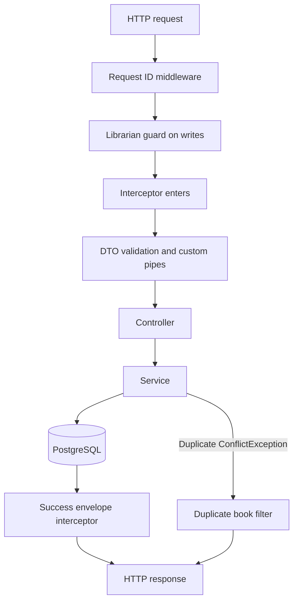

# Library Books API - Project 2

A complete NestJS classroom API built from the Library assignment. It uses PostgreSQL and TypeORM, following the controller/service/module approach in the [students reference](https://github.com/akhil3969/nest-students). The reference contains unresolved merge markers in its controller; this project implements the library requirements independently.

## 1. Open the project

Open this folder in VS Code, then choose Terminal > New Terminal. Run all commands below from this folder. You already have a Nest project: do not generate another one.

Prerequisites: Node.js 22.12 or newer (Node 24 LTS recommended), npm, a running local PostgreSQL server, and Git. Check `node -v`, `npm -v`, and `git --version`. If Git asks for Apple developer tools, run `xcode-select --install` and finish the installer.

## 2. Install dependencies

```bash
npm install
```

The existing dependencies supply Nest, DTO validation, configuration, PostgreSQL, and TypeORM. No extra application library was needed.

## 3. Configure the database

Copy the example configuration once, if you do not already have a .env file:

```bash
cp -n .env.example .env
```

Check your existing .env against [.env.example](./.env.example). Use your local PostgreSQL credentials:

```dotenv
DATABASE_HOST=localhost
DATABASE_PORT=5432
DATABASE_USER=postgres
DATABASE_PASSWORD=your_local_postgres_password
DATABASE_NAME=library
DATABASE_SYNCHRONIZE=true
```

The port and username above are common defaults; replace them with your actual local settings. Preserve any existing Observe credentials. Never upload .env.

## 4. Create the local database

In pgAdmin, connect to your existing local PostgreSQL server. Right-click Databases > Create > Database, enter `library`, and save. Alternatively, run the following in the Query Tool while connected to the postgres maintenance database:

```sql
CREATE DATABASE library;
```

Skip creation if library already exists. Your configured user must own the database or have permission to create tables in its public schema. Start your local PostgreSQL service before running the API.

`DATABASE_SYNCHRONIZE=true` creates the books table when the API starts. It does not create the database itself. Use migrations for a production deployment.

The assignment PDF explicitly requests a database set up with docker-compose. This project now uses local PostgreSQL at your request; confirm that setup is acceptable for submission.

## 5. Start the API

```bash
npm run start:dev
```

Keep this terminal running. The API is at http://localhost:3000/books. The root route still returns the original Hello World message; use /books for the assignment. No frontend is required by the assignment.

## 6. Try the five endpoints

Use a second terminal or import [postman.json](./postman.json) into Postman. The collection has `baseUrl` and `bookId` variables; creating a book automatically updates bookId. IDs are database generated, so replace 1 below with the returned ID.

### List books (GET)

```bash
curl -i http://localhost:3000/books
```

An empty database returns:

```json
{"success":true,"requestId":"generated-uuid","count":0,"data":[]}
```

### Create a book (POST)

```bash
curl -i -X POST http://localhost:3000/books \
  -H 'Content-Type: application/json' \
  -H 'x-role: librarian' \
  -H 'x-request-id: my-first-request' \
  -d '{"title":"  the hobbit  ","genre":"fiction","publishedYear":1937}'
```

Expected: HTTP 201. The saved title is `The Hobbit`. The response has `success`, `requestId`, and `data`. The X-Request-Id header matches `my-first-request`. A single object has no count field.

### Read one book (GET)

```bash
curl -i http://localhost:3000/books/1
```

### Update only one field (PATCH)

```bash
curl -i -X PATCH http://localhost:3000/books/1 \
  -H 'Content-Type: application/json' -H 'x-role: librarian' \
  -d '{"publishedYear":1938}'
```

Only the supplied fields change. An unchanged title is allowed. Missing optional fields are allowed; explicit null values are rejected. An empty PATCH leaves an existing book unchanged.

### Delete a book (DELETE)

```bash
curl -i -X DELETE http://localhost:3000/books/1 -H 'x-role: librarian'
```

Returns HTTP 200 with the deleted book in the envelope. Reading that ID afterwards returns 404.

## 7. Demonstrate error handling

| Try this | Expected |
| --- | --- |
| POST, PATCH, or DELETE without x-role | 403 Forbidden |
| x-role: student | 403 Forbidden |
| Title containing only spaces or one character after trim | 400 Bad Request |
| genre: fantasy | 400 Bad Request |
| Year 1449, a future year, or 2000.5 | 400 Bad Request |
| Year as string "2000" or null | 400 Bad Request |
| Extra field such as id on create | 400 Bad Request |
| GET /books/abc | 400 Bad Request |
| GET/PATCH/DELETE with a missing numeric ID | 404 Not Found |
| Create the same title twice (including different capitalization) | 409 Duplicate Book |
| Rename another book to an existing title | 409 Duplicate Book |

Create the same title twice before deleting it to demonstrate:

```json
{"error":"Duplicate Book","statusCode":409,"timestamp":"ISO date","path":"/books"}
```

Errors are not wrapped in the success envelope. Requests to book routes still receive X-Request-Id on errors.

## 8. Understand what was created, in learning order

1. **Entity:** [book.entity.ts](./src/books/entities/book.entity.ts) maps a book to PostgreSQL columns: generated integer id, unique title, genre enum, and integer publishedYear. The unique constraint also protects concurrent duplicate inserts.
2. **DTOs:** [create-book.dto.ts](./src/books/dto/create-book.dto.ts) requires a string title, one of the three genres, and an integer year. [update-book.dto.ts](./src/books/dto/update-book.dto.ts) reuses those rules but makes fields optional for PATCH.
3. **Service/provider:** [books.service.ts](./src/books/books.service.ts) contains the database operations. Nest injects a Repository<BookEntity>. findAll lists, findOne checks for 404, create saves, update merges supplied fields, and remove deletes. Duplicate titles throw ConflictException("Book already exists"). A PostgreSQL unique violation becomes the same exception.
4. **Controller:** [books.controller.ts](./src/books/books.controller.ts) connects GET/POST/PATCH/DELETE URLs to service methods. ParseIntPipe converts URL IDs to numbers. Body ValidationPipe rejects missing/invalid/unknown fields before the custom pipes run.
5. **Pipes:** [title-format.pipe.ts](./src/pipes/title-format.pipe.ts) trims and title-cases words, rejecting titles shorter than two characters after trimming. [published-year-validation.pipe.ts](./src/pipes/published-year-validation.pipe.ts) checks 1450 through the current year. Both skip omitted PATCH fields. The current year is computed at request time.
6. **Guard:** [librarian.guard.ts](./src/guards/librarian.guard.ts) requires exactly x-role: librarian on writes. GET routes are public. This header rule demonstrates the assignment; it is not a login system.
7. **Middleware:** [request-id.middleware.ts](./src/middleware/request-id.middleware.ts) reuses x-request-id or generates a UUID, attaches requestId to the request, and sets the response header.
8. **Interceptor:** [response-envelope.interceptor.ts](./src/common/interceptors/response-envelope.interceptor.ts) wraps successful results and adds count only for arrays. It is attached at controller level.
9. **Filter:** [duplicate-book.filter.ts](./src/filters/duplicate-book.filter.ts) catches ConflictException on POST and PATCH and produces the exact required error shape.
10. **Module:** [books.module.ts](./src/books/books.module.ts) registers the entity repository, controller, service, guard, pipes, filter, and interceptor. It applies request ID middleware to book routes through configure().
11. **Root setup:** [app.module.ts](./src/app.module.ts) loads and validates environment settings, connects TypeORM to PostgreSQL, imports BooksModule, and retains Observe. [main.ts](./src/main.ts) creates the application and starts its HTTP listener.

Nest decorators are labels the framework reads: @Controller declares a route group, @Get/@Post declare endpoints, @Injectable permits dependency injection, and @Module groups related components. Constructor injection supplies a ready-made dependency instead of manually calling new.

## 9. Explain the request lifecycle to your professor



Example: POST with `the hobbit` first gets a request ID; the guard checks the librarian role; DTO validation checks field types/genre; pipes normalize the title and check the year; the controller calls the service; the service saves through TypeORM; the interceptor wraps the result. A duplicate exception takes the filter path instead of returning success. Other exceptions use Nest's normal error handling.

## 10. Run checks

```bash
npm run build
npm run lint
npm test -- --runInBand
npm run test:e2e -- --runInBand
```

The unit tests check service duplicate handling and missing records. The HTTP suite exercises the real BooksModule controller, service, middleware, guard, pipes, filter, and interceptor with an in-memory repository replacement. It does not prove PostgreSQL persistence. Use the manual CRUD requests against your local PostgreSQL server to verify the real database; restart the API and GET the created book to confirm persistence.

## 11. Upload to your repository

The intended remote is https://github.com/akhil3969/librarybooks-api.git. Verify it first:

```bash
git remote -v
git status
```

Confirm .env and node_modules are not staged. Then:

```bash
git add .
git commit -m "Complete library books API project"
git push -u origin HEAD
```

This pushes the current branch. No need to overwrite or copy the professor's repository. Submit your own repository link and complete project folder as your assignment requests.

## Troubleshooting

- Database connection refused: start your local PostgreSQL service and check .env DATABASE_PORT (usually 5432).
- Password failure: use your local PostgreSQL user password. Changing .env alone does not reset a database password.
- Port 3000 in use: choose another PORT in .env and update the request URLs/Postman baseUrl.
- 403 on write: include x-role: librarian exactly.
- 409 on create: use a different title or update the existing book.
- Cannot find module: run npm install from this folder.

Documentation: [Nest TypeORM](https://docs.nestjs.com/data/typeorm.md), [Nest validation](https://docs.nestjs.com/application/validation.md).
